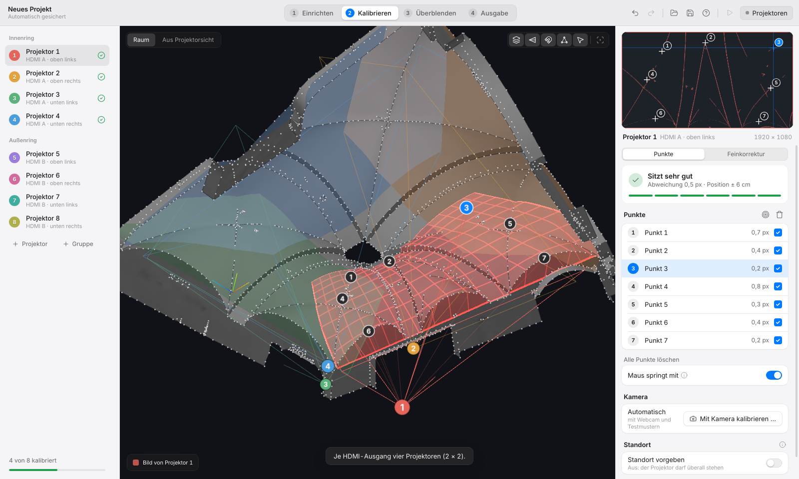
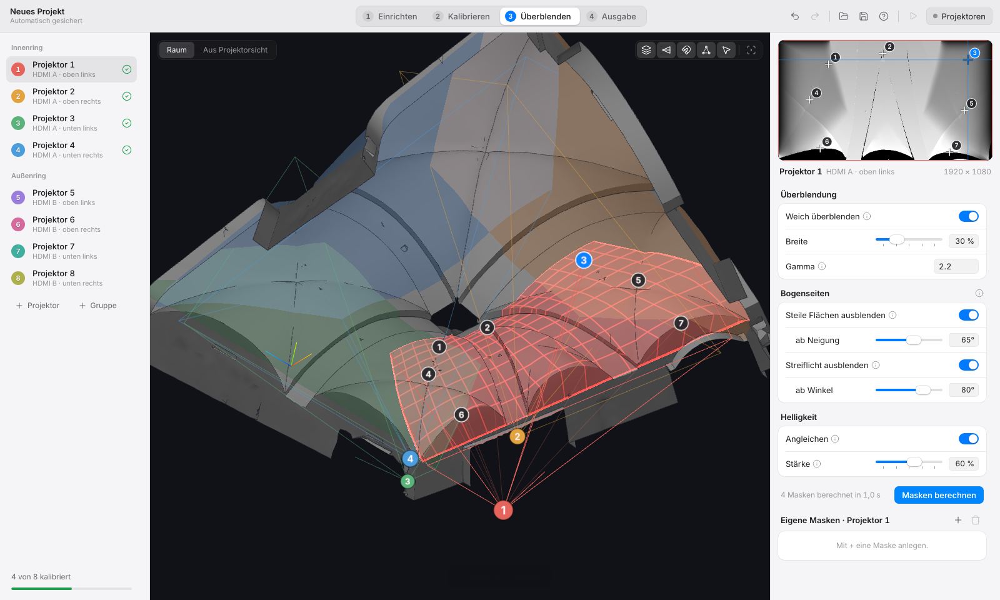
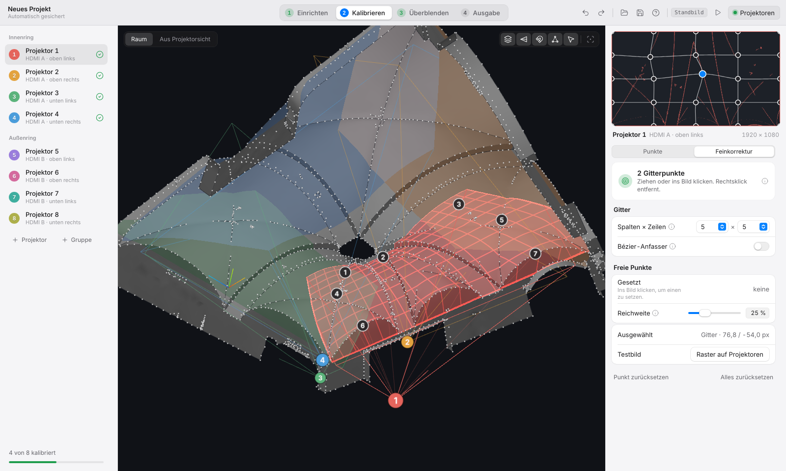

# Projection Studio

[Deutsch](README.md) · English

Projection Studio is a tool for 3D projection mapping on macOS and Windows. It determines the pose and optics of each projector from a few point correspondences between a 3D model (OBJ) and the real projected image. On that basis it computes blend masks with brightness compensation, allows fine correction with a grid and freely placed points, and either plays the result itself or hands it over to TouchDesigner.



> **Beta.** Projection Studio grew out of one specific installation and has been tried there, but hardly anywhere else. Bugs and gaps are likely, see [Features and limits](#features-and-limits). If it still helps someone with their own project, I'm glad.

The interface is in German by default. Switch to English under *View → Language* (Ansicht → Sprache) or in the help popover (?).

## Background

Projection Studio was created for teaching. The starting point was an installation on a vaulted ceiling, driven by TouchDesigner:

- 8 × Epson EB-535W (short throw), projecting via floor mirrors, image flipped in the projector
- large vertical lens offset, 4 projectors in an inner ring around a central column, 4 in an outer ring
- fed from one computer over 2 × 4K, each output split to 4 projectors by a video wall controller (LogiLink HD0054)
- playback of video from 2K upward across all projectors

For teaching, these were the only projectors available. They are rather unsuited to a vaulted ceiling: short-throw lenses with strong distortion towards the edges, a lens offset that puts the whole image on one side of the lens axis, and the detour via mirrors on the floor. The mirrors are needed because the projectors must not be tilted: according to the [user's guide](https://download.epson.com.sg/manuals/EB-535W_User%20Guide.pdf) (section *Installing the Projector*), the projector is to be placed level and parallel to the screen, must not be used on its side, and wall or ceiling mounting requires a dedicated mount. Pointing the projector steeply up at the ceiling is not intended. So the projectors sit level and a mirror directs the image upwards. Projectors with lens shift and a suitable focal length would have made many things easier. So a solution had to be found that works with the equipment at hand.

The software is not tied to this setup. Any geometry available as OBJ can be used. The vault is included as a demo.

## Existing tools

There are a number of established tools for projection mapping, among them:

- **camSchnappr** and **Stoner** as TouchDesigner components (camera calibration from point pairs, and 2D warping)
- **Kantan Mapper** in TouchDesigner for planar mapping
- **MadMapper**, **Resolume Arena**, **HeavyM** and **Millumin** for mapping and playback, mostly on flat surfaces and simple geometry
- media servers such as **disguise**, **Pixera** and **Watchout**, which cover 3D calibration, blending and playback for large productions
- camera-based auto-calibration, for example from **VIOSO** or **scalable display technologies**

## Why a separate tool

None of these fitted the setup above well. With camSchnappr, calibration was time-consuming and hard to reproduce. The distinctive points in the vault lie close together, and without assumptions about the optics the solution became unstable with such points. There was no independent view in which to judge the result. MadMapper did not reach a usable result with mirrors, lens offset and the vault. Media servers and camera-based systems can do this, but are tied to their own hardware and licences and are not appropriate for a teaching installation running TouchDesigner.

This led to the requirements for this tool:

- a calibration that stays stable with few, awkwardly placed points, because lens, lens offset and approximate position enter as prior knowledge
- direct feedback in a 3D view and on the projectors, so it is clear what the solution does
- blending, fine correction and test patterns in one place, without extra components
- a hand-over to TouchDesigner that fits into existing networks
- its own playback, so the installation can run without TouchDesigner
- runs on an ordinary computer under macOS and Windows, understandable for students without prior experience

## Technical approach

**Calibration.** Each projector is modelled as a pinhole camera with 9 parameters (rotation, position, focal length, principal point). The solution is a MAP estimate: reprojection error in pixels plus weighted deviations from the lens and position priors, minimised with Levenberg-Marquardt from several starting poses. Mirrored projection is taken into account. The solver runs in a web worker, so the interface stays responsive. Quality is reported as RMS error, positional uncertainty and the spread of the points across the image.

**Blending.** For each projector the GPU determines which other projectors hit the same surface. Each projector's share follows the irradiance E ∝ cos(angle of incidence) / (distance² · cos³(off-axis angle)), softened towards the image edges and with adjustable gamma. Surfaces beyond a limit angle can be excluded. Custom masks with soft edges are multiplied in.

**Fine correction.** Two layers per projector. A grid with 2 × 2 to 33 × 33 control points, columns and rows chosen separately, interpolated bicubically (Hermite). Without further edits this equals Catmull-Rom; optionally Bézier handles can be dragged at each grid point to bend the lines. On top come freely placed points anywhere in the image. Each acts through a Wendland kernel with limited reach, and the weights are solved so that every point hits its target exactly. A newly placed point pins the image in place until it is dragged. If the image folds over because of too strong corrections, the app warns.

For output the mapping is inverted: for every output pixel its source position, using Newton's method. In the app this happens in a background thread as a lookup table (coarse while dragging, then 480 × 270 samples, error below 0.2 px) that the GPU interpolates linearly. The cost per frame therefore does not depend on the number of points. For TouchDesigner a GLSL shader is generated with the same values as constants, computing the inverse directly. It matches the app to about 0.001 px.

**Output and playback.** One full-screen window per output. Each projector is rendered into its own multisampled render target and then placed into its cell in a single pass together with fine correction and mask. Video is mapped onto the model (top view or model UVs). All windows follow a shared clock and correct small drift via playback rate, larger drift by seeking.

## Outputs and video wall controllers

The app supports video wall controllers (also called video wall processors) that split one 4K signal into 2 × 2 Full HD signals. In the vault this is one LogiLink HD0054 per output. Comparable devices are made by Matrox (QuadHead2Go for 2 × 2 or 4 side by side, TripleHead2Go for 3 side by side), Datapath, StarTech and Lindy, among others.

Reasons for this approach:

- **More projectors on one computer.** Typical graphics cards have four outputs, often fewer. With two controllers, eight projectors run from two outputs.
- **Same frame timing.** The four projectors on one controller receive their images from one shared 4K frame.
- **Simple on the software side.** To the operating system each controller is a single 4K display. The app opens one full-screen window on it and places the four projector images into the cells.

Under *Set up* the controller mode is chosen per output: *2 × 2*, *2 side by side*, *2 stacked*, *3 side by side*, *4 side by side* or *4 stacked*, or *Full* when a projector is connected directly. The projectors of that output are then assigned to the cells in order. If the display resolution does not match the mode, a hint appears next to it. On the controller itself, use the plain mode without bezel correction; overlap and blending are handled by the app.

Displays are assigned from a menu. Outputs open borderless and full screen on the chosen display, on macOS and Windows. The assignment is kept after unplugging or a change of resolution.

For calibration there is also a **test output**. A single projector can be connected directly without a controller, and this output always shows the currently selected projector full frame. With the *Mouse follows* option, the mouse pointer jumps to that projector's image when switching projectors, on the test output or in the right cell of the controller.

## Workflow

1. **Set up.** Load the model, enable projectors, set lens, mirror, resolution, output and cell.
2. **Calibrate.** Select a projector, click distinctive points in the model and hit them in the projected image, with the mouse on the projector, in the preview or with the arrow keys (1 px, with ⇧ 10 px). Compensate remaining errors in the *Fine correction* tab.
3. **Blend.** Compute masks, adjust the limit angle and transitions, draw custom masks.
4. **Output.** Test patterns or video on the projectors, export or live link to TouchDesigner.

<p>
  
  
</p>

Projects are saved automatically, and every step can be undone. On first launch an introduction walks through the setup and offers to start with the demo. The screenshots show the German interface.

## Features and limits

| | |
|---|---|
| Projectors | up to 8 per project, each can be disabled. The number is fixed; more than 8 is currently not possible. |
| Outputs | 2 outputs for video wall controllers (HDMI A, HDMI B) and 1 test output for a directly connected projector, all on the same computer |
| Controller modes | *Full*, *2 × 2*, *2 side by side*, *2 stacked*, *3 side by side*, *4 side by side*, *4 stacked*. All cells of an output have the same size. |
| Resolution per projector | 1920 × 1080, 1280 × 800, 1280 × 720 or 3840 × 2160 (resolution of the signal, not the panel) |
| 3D model | OBJ only; materials and textures are ignored. The demo has about 16,000 triangles; much larger models are untested. |
| Lenses | presets for Epson EB-535W, standard projectors with fixed offset, centred lens shift, and *Unknown*. Lens distortion is not modelled; fine correction compensates the rest. |
| Calibration | from 4 point pairs, 6 well-spread points are ideal |
| Fine correction | grid of 2 to 33 control points per direction, optional Bézier handles, up to 200 free points per projector |
| Masks | automatic blending, custom polygon masks with soft edges |
| Video | formats Chromium can play: H.264 and AAC in MP4/MOV, VP8, VP9 and AV1 in WebM/MKV. H.265/HEVC only where the system decodes it in hardware. ProRes, HAP, DXV and image sequences are not supported. No audio output. The achievable resolution depends on decoder and graphics card. |
| TouchDesigner | export (JSON, masks as PNG, GLSL shader, Python script) and live link via OSC |
| Languages | German (default), English |
| Systems | macOS 11 or later (Apple Silicon and Intel), Windows 10/11 64-bit; graphics card with WebGL 2 |

Known limitations:

- The Mac app is not signed or notarised by Apple, so the first launch needs a workaround (see below).
- No automatic updates while the repository is private.
- Performance with 8 projectors on 2 × 4K has not yet been measured on the target machine. The app shows the frame rate per output.
- *Mouse follows* and switching between displays have not yet been tried on real hardware under macOS and Windows.
- The TouchDesigner integration is tested against a mock of the TD API, and only partly on a real installation.
- No camera-based auto-calibration. Flat screens also need a (simple) OBJ model.
- Multiple computers working together are not supported.

## Download

The current version is built automatically on every change:

- [macOS (.dmg)](https://github.com/BenjaminJMueller/projection-studio/releases/latest/download/Projection-Studio-mac.dmg)
- [Windows, installer (.exe)](https://github.com/BenjaminJMueller/projection-studio/releases/latest/download/Projection-Studio-Setup.exe)
- [Windows, portable (.exe)](https://github.com/BenjaminJMueller/projection-studio/releases/latest/download/Projection-Studio-Portable.exe)

Older builds are under [Releases](https://github.com/BenjaminJMueller/projection-studio/releases). The version number is shown in the *Help* menu.

The Mac app is not signed by Apple. On first launch, right-click it in the Finder and choose *Open*, or run this once in Terminal:

```sh
xattr -dr com.apple.quarantine "/Applications/Projection Studio.app"
```

On Windows, SmartScreen may complain. Click *More info* and then *Run anyway*.

An auto-updater is built in but switched off, because the app cannot read the releases of a private repository without signing in. To use it, put the address of a publicly reachable `latest.json` under `updateFeed` in `package.json`. The build already produces that file.

## TouchDesigner

Under *Output → TouchDesigner → Export …* choose the folder of the `.toe` file. A folder `kalibrierung/` is created there:

```
kalibrierung/
  kalibrierung.json        cameras of all projectors (position, rotation, FOV, lens shift)
  masken/Px.png            blending and custom masks
  feinkorrektur/Px.frag    shader for a GLSL TOP, if a fine correction is set
  apply_calibration.py     script that applies everything
  osc_callbacks.py         counterpart for the live link
```

Put `apply_calibration.py` into a Text DAT in the same network as the cameras, then *Run Script*. The script sets up each camera (the name is set per projector under *Set up*, default `Kamera_Px`) and then checks by itself that the projection is right. With `SETUP_MASKS = True` at the top of the script, it also inserts mask and fine correction after each Render TOP:

```
Projektion_Px → Blend_Px (× Maske_Px) → Fein_Px (GLSL TOP) → …
```

Running the script a second time only updates what is already there.

For the live link, TouchDesigner needs an OSC In DAT on port 7000 with `osc_callbacks.py` as its Callbacks DAT; details are at the top of that file. Then switch on *Live send* under *Output* in the app. From then on every change goes straight to the cameras.

## Development

With Node.js 22:

```sh
npm install
npm start          # start the app
npm test           # unit tests: solver, export, TD script, OSC, playback, fine correction
npm run test:e2e   # click through the whole app once, screenshots go to test-output/
npm run dist       # build an installer for the current system
```

On Linux without a display, run the E2E test with `xvfb-run -a npm run test:e2e`.

Main folders:

```
src/main/       main process: windows, displays, files, OSC, updates
src/renderer/   interface, 3D view, preview, blending, solver in a worker
src/output/     full-screen window per output (scene, fine correction and mask on the GPU)
src/core/       solver, export, OSC
src/shared/     project format, masks, playback, warp grid, translation
examples/       demo vault
td/             scripts for TouchDesigner
test/           tests and test video
```

## Licence

Private, all rights reserved, see [LICENSE](LICENSE). three.js is MIT-licensed.
