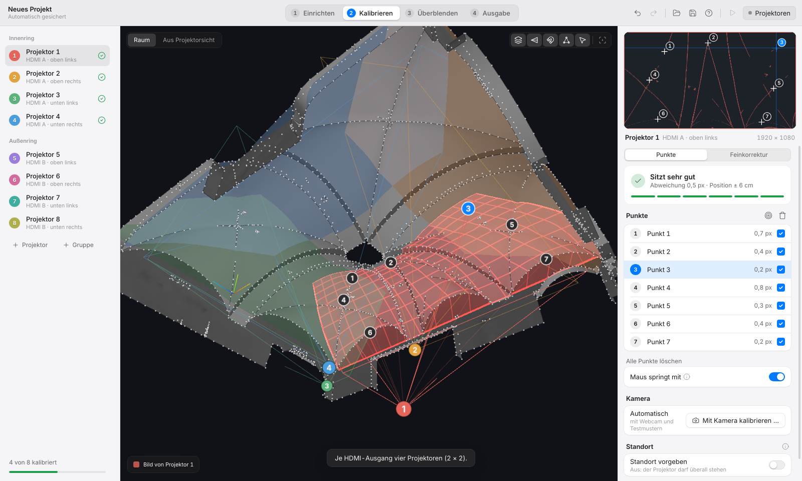
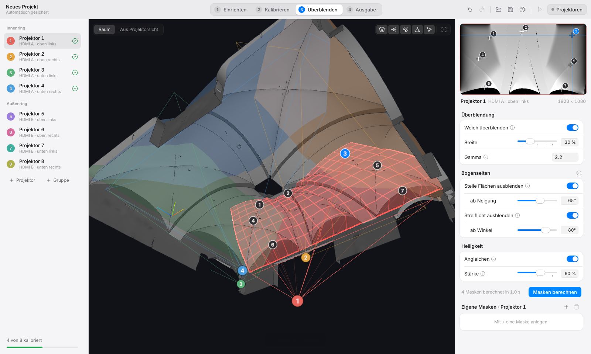
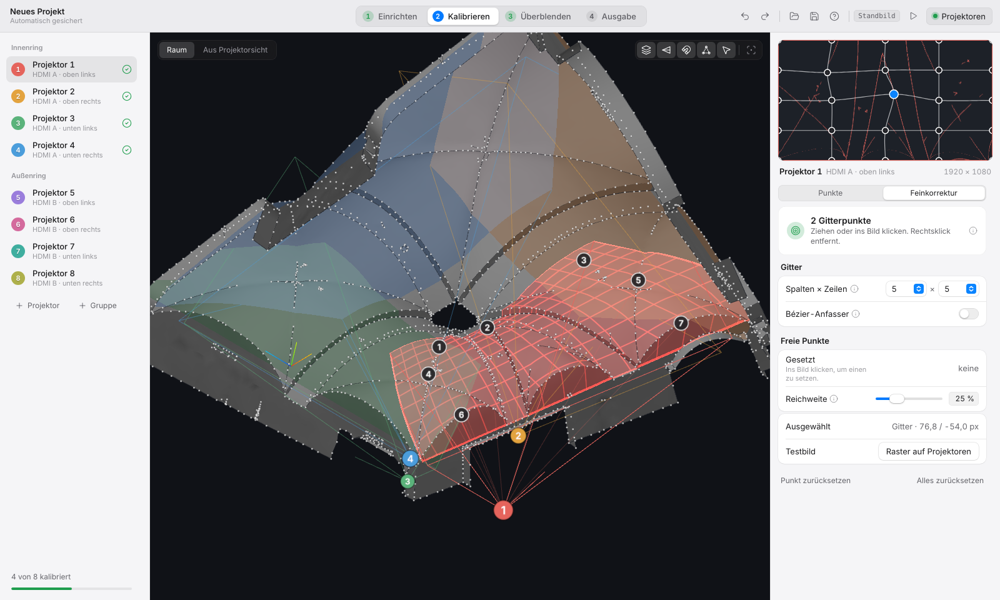

# Projection Studio

Projektoren gegen ein 3D-Modell kalibrieren, automatisch überblenden, fein korrigieren und Videos direkt abspielen, mit Anbindung an TouchDesigner. Läuft unter macOS und Windows.

Gebaut für eine Gewölbedecke mit acht Kurzdistanz-Projektoren (4 im Innenring, 4 im Außenring, über Bodenspiegel), die über zwei 4K-Ausgänge mit je vier Bildern laufen. Die App ist aber nicht auf diesen Aufbau festgelegt.



## Was die App kann

| Schritt | Inhalt |
| --- | --- |
| **1 Einrichten** | 3D-Modell (OBJ) laden, Projektoren anlegen, Auflösung, Objektiv und Spiegel einstellen, HDMI-Ausgang und Bildviertel zuweisen. |
| **2 Kalibrieren** | Punkte im Modell anklicken und auf der echten Decke platzieren, direkt am Projektor oder in der Vorschau. Die Lage jedes Projektors wird laufend neu berechnet, mit Gütewert und Vorschlägen für die nächsten Punkte. Im Reiter **Feinkorrektur** lässt sich das Bild pro Projektor über ein Gitter mit 3×3 bis 9×9 Punkten nachziehen, als Ersatz für Stoner. |
| **3 Überblenden** | Weiche Überblendmasken für alle Überlappungen berechnen, mit Helligkeitsausgleich. Steile Flächen wie Wände und Bogenseiten bleiben dunkel. Eigene weiche Masken lassen sich pro Projektor zeichnen. |
| **4 Ausgabe** | Vollbild auf den Projektoren ausgeben: Video, Kanten, Raster, Weiß oder Projektornummer. Export und Live-Verbindung zu TouchDesigner. |

Die eigene **Videowiedergabe** spielt ein Video auf dem Modell ab, über alle Projektoren mit Überblendung, Masken und Feinkorrektur. Beide Ausgänge laufen über eine gemeinsame Uhr synchron. Die Bildrate je Ausgang wird beim Abspielen angezeigt.

<p>
  
  
</p>

## Installation

**Direkt herunterladen** (neueste Version, wird bei jeder Änderung automatisch neu gebaut):

- [Projection Studio für macOS (.dmg)](https://github.com/BenjaminJMueller/projection-studio/releases/latest/download/Projection-Studio-mac.dmg)
- [Projection Studio für Windows, Installer (.exe)](https://github.com/BenjaminJMueller/projection-studio/releases/latest/download/Projection-Studio-Setup.exe)
- [Projection Studio für Windows, ohne Installation (.exe)](https://github.com/BenjaminJMueller/projection-studio/releases/latest/download/Projection-Studio-Portable.exe)

Alle Versionen stehen unter [Releases](https://github.com/BenjaminJMueller/projection-studio/releases). Ein Tag `v*` (z. B. `v1.1.0`) legt zusätzlich ein festes Release mit dieser Versionsnummer an.

- **macOS**: `.dmg` öffnen und die App in „Programme“ ziehen. Die App ist nicht von Apple signiert. Beim ersten Start deshalb im Finder Rechtsklick → **Öffnen**, oder im Terminal:
  ```sh
  xattr -dr com.apple.quarantine "/Applications/Projection Studio.app"
  ```
- **Windows**: Installer ausführen oder die Version ohne Installation direkt starten. Falls SmartScreen warnt: **Weitere Informationen → Trotzdem ausführen**.

### Updates

Die App prüft beim Start, ob es eine neuere Version gibt, und fragt dann nach. Auf dem Mac lädt sie das Update, prüft die Prüfsumme, tauscht sich nach dem Beenden selbst aus und startet neu. Ein Apple-Entwicklerkonto ist dafür nicht nötig. Unter Windows startet sie den neuen Installer. Von Hand geht es über **Hilfe → Nach Updates suchen …**.

Jeder Push auf `main` erzeugt eine neue Version mit fortlaufender Nummer (`1.0.<Build>`). Die Update-Information liegt als `latest.json` im Release. Die App liest sie ohne Anmeldung, deshalb funktioniert das nur, wenn die Releases öffentlich erreichbar sind. Die Adresse steht in `package.json` unter `updateFeed`.

## Arbeitsablauf in Kürze

1. **Modell laden** (Einrichten). Ein Beispiel liegt in `examples/`.
2. **„Projektoren“** oben rechts einschalten. Jeder Projektor zeigt dann seine Nummer.
3. **Kalibrieren**: Projektor links wählen, einen gut erkennbaren Punkt im Modell anklicken (Kante, Ecke, Bogenscheitel) und dieselbe Stelle auf der Decke anklicken oder hinziehen. Ab 6 gut verteilten Punkten ist die Lösung stabil. Pfeiltasten verschieben den aktiven Punkt um 1 px, mit ⇧ um 10 px.
4. Bei Bedarf **Feinkorrektur**: Testbild „Raster“ ausgeben und die Gitterpunkte nachziehen, bis die Linien passen.
5. **Überblenden → Masken berechnen**.
6. **Ausgabe**: Video wählen und abspielen, oder nach TouchDesigner exportieren.

Das Projekt wird automatisch gesichert. Rückgängig/Wiederholen mit Strg/Cmd+Z und ⇧+Strg/Cmd+Z. Die Einführung lässt sich unter **Hilfe → Einführung anzeigen** erneut öffnen.

## TouchDesigner

**Export** (Ausgabe → TouchDesigner → Exportieren …) legt neben der `.toe`-Datei einen Ordner `kalibrierung/` an:

```
kalibrierung/
  kalibrierung.json        Kameras (Position, Rotation, FOV, Lens Shift) aller Projektoren
  masken/Px.png            Überblendung × eigene Masken
  feinkorrektur/Px.frag    GLSL-TOP-Shader, nur wenn eine Feinkorrektur gesetzt ist
  apply_calibration.py     Skript zum Übernehmen
  osc_callbacks.py         Empfänger für die Live-Verbindung
```

**Übernehmen**: `apply_calibration.py` in einen Text DAT im Netzwerk der Kameras kopieren und **Run Script** ausführen. Das Skript stellt jede Kamera ein (Name je Projektor unter Einrichten, Standard `Kamera_Px`) und prüft das Ergebnis gegen die berechnete Projektionsmatrix. Mit `SETUP_MASKS = True` fügt es pro Projektor hinter `Projektion_Px` zusätzlich ein:

```
Projektion_Px → Blend_Px (× Maske_Px) → Fein_Px (GLSL TOP) → …
```

Vorhandene Operatoren werden bei einem erneuten Lauf nur aktualisiert.

**Live (OSC)**: In TouchDesigner einen OSC In DAT auf Port 7000 anlegen und als Callbacks DAT `osc_callbacks.py` setzen (Anleitung im Kopf der Datei). In der App unter Ausgabe → TouchDesigner „Live senden“ einschalten. Jede Änderung der Kalibrierung landet dann sofort auf den Kameras.

## Entwicklung

Voraussetzung: Node.js 22.

```sh
npm install
npm start          # App starten
npm test           # Syntaxprüfung und Unit-Tests (Solver, Export, TD-Skript, OSC, Wiedergabe, Feinkorrektur)
npm run test:e2e   # Klickpfad durch die ganze App mit Screenshots in test-output/
npm run dist       # Installer für das aktuelle System bauen
```

Unter Linux ohne Bildschirm den E2E-Test mit `xvfb-run -a npm run test:e2e` starten.

### Aufbau

```
src/main/        Electron-Hauptprozess: Fenster, Bildschirme, Ausgabefenster, Dateien, OSC
src/renderer/    Hauptfenster: Oberfläche (app.js), 3D-Ansicht, Projektorvorschau, Blend-Berechnung, Solver-Worker
src/output/      Vollbild-Ausgabefenster je HDMI-Ausgang (GPU: Szene → Feinkorrektur → Maske)
src/core/        Solver (Lochkamera, 9 Parameter, Levenberg-Marquardt), Export, OSC
src/shared/      Projektformat, Szene, Masken, Wiedergabe-Uhr, Verzerrungsgitter
td/              Skripte für TouchDesigner
test/            Unit-Tests, E2E-Test, Testvideo
```

## Lizenz

Privat, alle Rechte vorbehalten. Siehe [LICENSE](LICENSE). three.js steht unter MIT-Lizenz.
